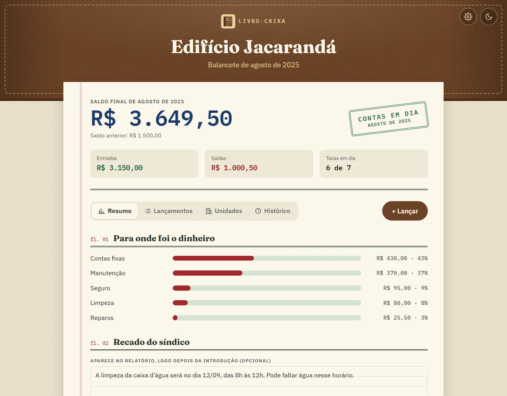
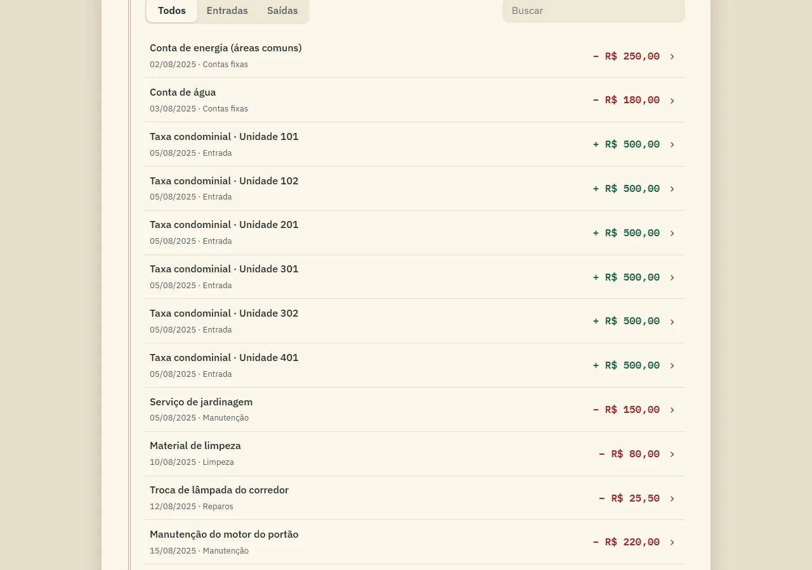
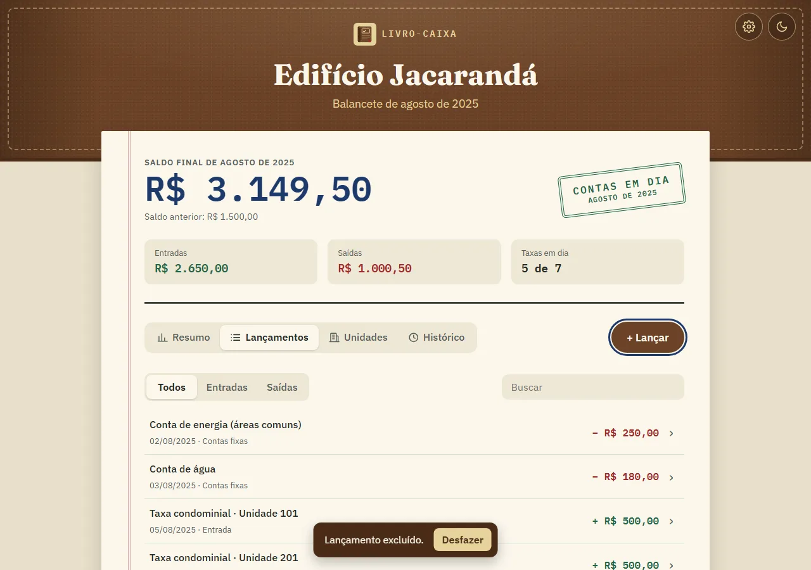

<div align="center">


# Livro-Caixa

**A prestação de contas do condomínio, do caderno do síndico ao celular dos moradores.**

O síndico lança as entradas e saídas do mês, confere o saldo e gera um relatório só de leitura para enviar aos condôminos.<br>
Feito com **HTML, CSS e JavaScript puro**, sem frameworks, sem bibliotecas e sem etapa de build.

[**🌐 Ver o site no ar**](https://livro-caixa-condominio.netlify.app) · [Testes no ar](https://livro-caixa-condominio.netlify.app/testes.html) · [Recursos](#-recursos) · [Como rodar](#-como-rodar) · [Decisões técnicas](#-decisões-técnicas) · [Testes](#-testes) · [Limitações](#-limitações-e-próximos-passos) · [Uso de IA](#-uso-de-ia) · [Autor](#-autor)


</div>

---

## 📸 Capturas de tela

<p align="center">
  
  <br><em>O mais importante primeiro: o saldo do mês, os totais e as abas</em>
</p>

<p align="center">
  
  <br><em>Lançamentos num extrato só, com filtro e busca. Tocar numa linha abre a ficha</em>
</p>

<p align="center">
  
  <br><em>Ficha no estilo das sheets do iOS: Cancelar, Salvar e Excluir no mesmo lugar</em>
</p>

<p align="center">
  
  <br><em>Nada de "Tem certeza?": a ação acontece e o aviso oferece Desfazer (ou Ctrl+Z)</em>
</p>

<p align="center">
  
  <br><em>Taxas por unidade: ligar o interruptor lança a taxa nas entradas</em>
</p>

<p align="center">
  
  <br><em>Histórico com saldo mês a mês, no tema escuro</em>
</p>

<p align="center">
  
  <br><em>O relatório que os moradores recebem: um arquivo .html único, só de leitura</em>
</p>

<p align="center">
  
  &nbsp;
  
  &nbsp;
  
  <br><em>No celular, as abas viram a barra de baixo e as fichas sobem da borda, como nos apps do iPhone</em>
</p>

> O Edifício Jacarandá, a síndica e todos os valores são **fictícios**.

---

## 📖 Sobre o projeto

Em muitos prédios pequenos, a prestação de contas ainda é uma planilha improvisada ou uma foto do caderno do síndico no grupo do condomínio. O Livro-Caixa resolve isso com duas peças:

- **o livro do síndico** (`index.html`), onde ele lança, edita e confere os valores do mês;
- **o relatório dos moradores**, gerado com um clique: um arquivo `.html` único, sem JavaScript, que abre em qualquer celular e pode ser impresso em PDF.

A primeira versão deste projeto tinha duas pastas separadas, e para publicar o síndico precisava copiar um trecho de código e colar à mão em outro arquivo. Voltei a ele para corrigir falhas (entre elas uma brecha de segurança), tirar esse passo manual e dar ao projeto uma identidade própria: a de um **livro contábil**, com capa de couro marrom e costura dourada, como uma pasta de arquivo, folha creme com pauta, margem vermelha dupla, números em fonte monoespaçada e um carimbo de conferência no saldo.

---

## ✨ Recursos

| Recurso | O que faz |
|---|---|
| **Saldo em destaque** | O saldo final aparece primeiro, grande, com o carimbo e os totais logo abaixo |
| **Abas** | *Resumo · Lançamentos · Unidades · Histórico*, usáveis com as setas do teclado; no celular viram a barra de baixo |
| **Um botão principal** | *+ Lançar* abre a ficha já com a escolha *Entrada / Saída* |
| **Toque para editar** | Tocar num lançamento ou numa unidade abre a ficha; o botão de excluir fica dentro dela |
| **Desfazer** | Excluir, fechar o mês ou trocar os dados acontece na hora, com *Desfazer* no aviso ou Ctrl+Z |
| **Busca e filtro** | Filtra por entradas ou saídas e busca ignorando acentos ("manutencao" acha "Manutenção") |
| **Fechar o mês com checklist** | Mostra o que falta (taxas pendentes, recado, relatório baixado) antes de fechar |
| **Configurações** | Nome do condomínio, mês, saldo anterior, síndico e contato ficam numa ficha aberta pela engrenagem |
| **Taxas por unidade** | Cadastro das unidades e da taxa de cada uma; marcar "Paga" lança a taxa nas entradas, e desmarcar a retira |
| **Entradas e saídas** | Lançar, editar e excluir, com data, descrição, categoria (nas saídas) e valor |
| **Valores do jeito brasileiro** | Aceita `50,50`, `1.234,56`, `R$ 80` e também `50.50` |
| **Validação de verdade** | Mensagens em português ligadas a cada campo; a data precisa ser do mês de referência |
| **Resumo com carimbo** | Saldo anterior + entradas − saídas = saldo final, com o carimbo *Contas em dia* ou *Saldo negativo* |
| **Para onde foi o dinheiro** | Barras com o total e o percentual de cada categoria de despesa |
| **Recado do síndico** | Um aviso do mês ("a limpeza da caixa d'água será no dia 12") que sai no topo do relatório |
| **Relatório para os moradores** | *Baixar relatório* gera `prestacao-de-contas-AAAA-MM.html`; *Ver relatório* abre uma prévia |
| **Taxas sem expor ninguém** | O relatório diz só "6 de 7 unidades em dia" e o valor em aberto, sem identificar nenhuma unidade |
| **Histórico** | *Fechar o mês* guarda o mês e abre o seguinte com o saldo final; cada mês fechado pode gerar o relatório de novo |
| **Saldo mês a mês** | Gráfico de barras com o saldo final de cada mês, incluindo o mês em aberto |
| **Cópia de segurança** | *Salvar cópia* baixa um `.json` com tudo (inclusive o histórico); *Abrir cópia* restaura em qualquer navegador |
| **Tema claro e escuro** | Segue o tema do sistema; o botão no canto da capa troca e lembra a escolha |
| **Salvo no navegador** | Tudo fica no `localStorage`: recarregar a página não apaga nada, e nada vai para servidor nenhum |
| **Testes automatizados** | `testes.html` roda 41 verificações das funções de contas, dados e relatório |
| **Exemplo com um clique** | *Restaurar exemplo* traz de volta o Edifício Jacarandá para quem quer só conhecer |

---

## 🚀 Como rodar

Para só conhecer, abra o [site no ar](https://livro-caixa-condominio.netlify.app): ele é publicado pelo Netlify, que atualiza o site sozinho a cada `git push` na `main`.

Para rodar no seu computador, não há dependências nem etapa de build: o código do repositório é o código que roda no navegador.

```bash
git clone https://github.com/gustavomenacho/Dashboard-Financeiro-Condominio.git
cd Dashboard-Financeiro-Condominio
```

Depois, abra o `index.html` no navegador (duplo clique funciona). Se preferir um servidor local, use a extensão **Live Server** do VS Code ou:

```bash
npx serve .
```

### Fluxo do mês

1. Na primeira vez, preencha as **configurações** (a engrenagem na capa).
2. Ligue as **unidades** que pagaram e use **+ Lançar** para as outras entradas e as saídas.
3. No **Resumo**, escreva um recado, se houver, clique em **Baixar relatório** e envie o arquivo aos moradores.
4. Quando o checklist estiver completo, clique em **Fechar o mês**. De vez em quando, salve uma **cópia de segurança**.

---

## 🗂️ Estrutura

```
index.html          o livro do síndico: painel do saldo, abas e fichas (<dialog>)
testes.html         testes automatizados, rodam no próprio navegador
css/
  style.css         identidade visual, cores dos temas claro e escuro, abas, listas e fichas
js/
  contas.js         funções puras: centavos, leitura de valores, datas, totais, unidades, escape de HTML
  dados.js          leitura segura dos dados salvos e das cópias .json
  relatorio.js      monta o relatório público (HTML + CSS embutido, sem JavaScript)
  app.js            estado, desenho da tela, abas, fichas, desfazer, unidades, histórico,
                    cópia de segurança e tema
img/
  logo.svg          logo e ícone da aba
docs/capturas/      imagens deste README
```

---

## 🧠 Decisões técnicas

**XSS → `textContent` e escape de HTML.** As tabelas eram montadas com `innerHTML`. Uma descrição como `` virava código executado, e justamente na página que todos os moradores abririam. Agora a tela do síndico cria cada célula com `createElement` e `textContent`, e o relatório passa todo texto por `escaparHTML()` antes de entrar no HTML. Testei com essa descrição: ela aparece como texto nos dois lugares.

**Copiar e colar código → relatório gerado como arquivo.** Para publicar, o síndico copiava um `const state = {...}` e colava dentro de um `.js` da versão pública. Um erro de colagem quebrava a página. Agora o botão *Baixar relatório* monta um `.html` completo com `Blob` e `URL.createObjectURL()`. O arquivo não tem JavaScript: os moradores só leem, e ele abre até offline.

**Dados que sumiam no F5 → `localStorage` com validação.** Nada era salvo, e recarregar a página apagava o mês inteiro. Agora o estado é gravado a cada mudança. Na leitura, um `try/catch` e uma checagem campo a campo evitam que um dado corrompido quebre o app: nesse caso, ele volta para o exemplo.

**Dados presos num navegador → cópia de segurança em `.json`.** O `localStorage` só existe naquele navegador, naquele computador. *Salvar cópia* baixa um arquivo com tudo, e *Abrir cópia* lê o arquivo escolhido no `<input type="file">` com `file.text()`. A mesma função que confere o `localStorage` confere a cópia: um arquivo de outro programa, ou editado à mão, é recusado com um aviso, e só os campos conhecidos são copiados.

**"Paga" num lugar, entrada em outro → uma fonte de verdade.** Guardar "a unidade 202 pagou" separado da entrada de R$ 500,00 deixaria as duas informações desencontradas. Por isso não existe um campo "pago": uma unidade está paga quando há uma entrada ligada a ela (`unidadeId`). Marcar a caixa cria a entrada; desmarcar, ou excluir a entrada, deixa a unidade pendente de novo.

**Expor o devedor → relatório só com números.** Divulgar a lista de inadimplentes para todos os vizinhos pode configurar constrangimento na cobrança. O relatório diz apenas "6 de 7 unidades em dia" e o valor em aberto. E, como listar as taxas pagas uma a uma ("Unidade 101", "Unidade 102"…) revelaria o devedor por eliminação, o relatório soma todas numa linha só: "Taxas condominiais (6 unidades)". O síndico continua vendo tudo, unidade por unidade, na tela dele.

**Fechar o mês apagava tudo → histórico.** Cada mês fechado é guardado inteiro (lançamentos, unidades e recado), copiado por inteiro para que mudanças futuras não alterem o passado. Por isso o relatório de qualquer mês antigo sai igual ao que foi enviado na época.

**`0.1 + 0.2` → centavos inteiros.** Somar dinheiro com números decimais gera erros como `0.30000000000000004`. Todos os valores são guardados em **centavos** (`2550` em vez de `25.5`) e só viram "R$ 25,50" na hora de exibir.

**`"50,50"` virava R$ 50,00 → leitor de valores brasileiro.** O `parseFloat("50,50")` para na vírgula e devolve `50`, sem avisar. A função `lerValor()` entende vírgula decimal, ponto de milhar e o prefixo `R$`, e devolve `null` quando o texto não é um valor.

**Edição pela metade → validar antes de salvar.** Se o síndico cancelasse a categoria ao editar uma despesa, a data, a descrição e o valor já tinham sido trocados. Agora a ficha valida todos os campos primeiro e só então altera o estado: ou salva tudo, ou nada.

**Sequência de `prompt()` → `<dialog>` nativo.** Os lançamentos eram feitos em janelas do navegador, uma após a outra. Agora há uma ficha com `showModal()`, que já entrega foco preso no modal, fechamento com Esc, fundo inerte e retorno do foco ao botão que a abriu.

**Duas cópias do código → uma fonte só.** As versões do síndico e pública tinham o mesmo CSS e a mesma lógica duplicados. Agora as contas ficam em `contas.js`, usado tanto pela tela quanto pelo relatório. O relatório tem um CSS próprio e enxuto embutido, porque precisa funcionar como um arquivo único.

**Scripts clássicos de propósito.** Usei `<script>` comuns em vez de módulos ES6, para que o síndico possa abrir o `index.html` com um duplo clique, sem servidor (módulos não carregam em `file://`).

**Acessibilidade.**
- As abas seguem o padrão de acessibilidade para abas (`role="tab"`, `aria-selected`) e funcionam com as setas, Home e End.
- Os interruptores das unidades são `<input type="checkbox" role="switch">`: o leitor de tela anuncia "Unidade 202 paga, desligado".
- Títulos em ordem e os totais em lista de definição (`<dl>`).
- Rótulos em todos os campos, erros ligados ao campo (`aria-describedby`, `aria-invalid`) e avisos anunciados por `role="status"`.
- Os itens do checklist dizem "Feito", "Falta" ou "Opcional" ao leitor de tela, e não só com a cor do ícone.
- O mês de referência deixou de ser um título clicável e virou um campo de verdade, usável pelo teclado.
- O verde da versão antiga tinha contraste de cerca de 2,3:1; as cores novas passam de 4,5:1 sobre o papel.
- Foco visível, link "Pular para o conteúdo" e animação só para quem não pede menos movimento.

**Página longa de 9 seções → painel e abas, seguindo as diretrizes da Apple.** Todas as seções tinham o mesmo peso, e o síndico rolava a página inteira para achar qualquer coisa. Usei três ideias das *Human Interface Guidelines*: **clareza** (o saldo aparece primeiro, grande), **hierarquia** (uma ação principal, *+ Lançar*) e **revelação progressiva** (o que se preenche uma vez, como o nome do condomínio, foi para as configurações). O resto virou quatro abas.

**Links "Editar / Excluir" em cada linha → tocar na linha.** As linhas tinham dois links cada, o que poluía a lista. Agora a linha inteira é um `<button>` que abre a ficha, com a setinha `›` que indica isso, e excluir fica dentro da ficha, longe de um toque acidental.

**"Tem certeza?" → Desfazer.** Caixas de confirmação interrompem toda hora e as pessoas acabam clicando em "Sim" sem ler. Antes de uma ação destrutiva (excluir, fechar o mês, abrir uma cópia), o app guarda uma cópia do estado. A ação acontece na hora, e o aviso oferece **Desfazer** por 7 segundos, ou Ctrl+Z, como no Mail e no Fotos.

**Responsivo.** No celular, as abas viram a barra fixa de baixo, as fichas sobem da borda inferior como as *sheets* do iOS e os botões têm pelo menos 44 px de altura. A versão antiga esticava a página para 573 px numa tela de 375 px.

**Chrome escurecendo o site sozinho → tema escuro desenhado.** Com o "modo escuro automático" do Chrome ligado, o navegador invertia as cores por conta própria, e o papel creme virava um marrom sem contraste. Agora o site tem um tema escuro pensado para a identidade (couro mais escuro, folha grafite, tinta creme), que segue o `prefers-color-scheme` do sistema ou a escolha feita no botão da capa. Como todas as cores são **tokens** no `:root`, o tema escuro não reescreve nenhuma regra: só troca os valores das variáveis. Um script curto no `<head>` aplica a escolha salva antes de a página aparecer, para não piscar claro e depois escuro. O relatório dos moradores é um documento para ler e imprimir, por isso declara `color-scheme: only light` e continua sempre no papel claro.

**Validação presa dentro do app → `dados.js` separado.** A conferência dos dados salvos ficava dentro do `app.js`, misturada com a tela, e não dava para testá-la sozinha. Separada num arquivo próprio, ela passa a ser testada como as outras funções puras.

---

## 🧪 Testes

Abra o `testes.html` no navegador (duplo clique funciona). Ele roda **41 testes** e mostra cada resultado na tela:

- **`lerValor`:** `"50,50"`, `"1.234,56"`, `"R$ 80"`, valores inválidos e negativos;
- **dinheiro e datas:** formatação em reais, soma em centavos sem erro de ponto flutuante, virada de ano, fevereiro de ano bissexto;
- **totais, categorias e unidades:** saldo final, percentuais, "paga = tem entrada ligada";
- **segurança:** escape de HTML e um relatório sem nenhum `<script>`, mesmo com uma descrição maliciosa;
- **privacidade:** o relatório não cita nenhuma unidade, nem as pagas;
- **`dados.js`:** recusa dados quebrados, descarta campos desconhecidos e aceita dados da versão antiga.

Não usei nenhuma biblioteca de testes: `teste()` roda uma função e anota se ela lançou erro, e `igual()` lança erro quando o resultado não é o esperado. São poucas linhas, e dá para ler e entender tudo.

<p align="center">
  
</p>

---

## 🚧 Limitações e próximos passos

**Por que não tem login.** Um login feito só no front-end não protege nada: o código vai inteiro para o navegador, e qualquer pessoa poderia ler a senha no JavaScript ou pular a tela de entrada. Login de verdade precisa de um servidor que confira a senha e guarde os dados. Sem servidor, a solução foi separar o que cada um recebe: o síndico tem a ferramenta de edição, e o morador recebe só o relatório, um arquivo sem JavaScript que ele lê mas não altera.

Essa escolha tem limites, e prefiro deixá-los claros:

- **Um síndico, um navegador.** Não dá para duas pessoas editarem ao mesmo tempo; a cópia `.json` é o jeito de levar os dados para outro computador.
- **O morador não tem como conferir a autenticidade** do arquivo que recebeu; ele confia em quem enviou.
- **Sem comprovantes.** As notas fiscais e os recibos não ficam anexados aos lançamentos.

O próximo passo natural é um back-end como serviço (**Supabase** ou **Firebase**): login para o síndico e para os moradores, dados num banco na nuvem e um link fixo para o relatório, no lugar do arquivo enviado pelo grupo.

---

## 🤖 Uso de IA

A primeira versão foi feita por mim. Nesta revisão, usei o **Claude (Anthropic)** como apoio para revisar o código e apontar falhas (como o XSS, os dados que se perdiam e os problemas de acessibilidade). As escolhas de identidade, nome e escopo foram minhas, e todo o código foi revisado e testado por mim no navegador.

---

## 👤 Autor

**Gustavo Menacho**: advogado em transição para o desenvolvimento front-end.

[](https://www.linkedin.com/in/gustavomenacho/)
[](https://github.com/gustavomenacho)
[](mailto:menacho1996@gmail.com)
